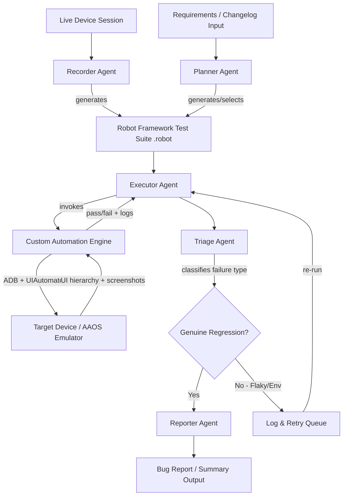
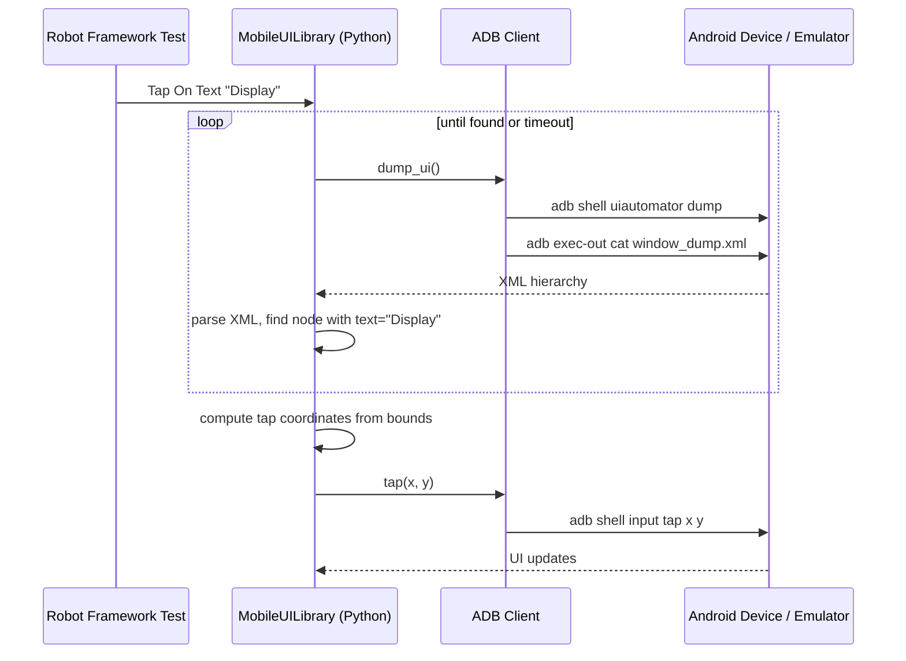
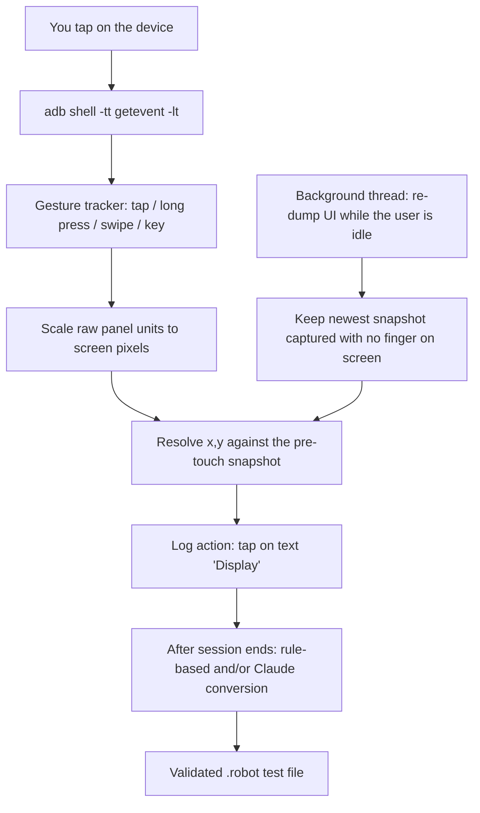
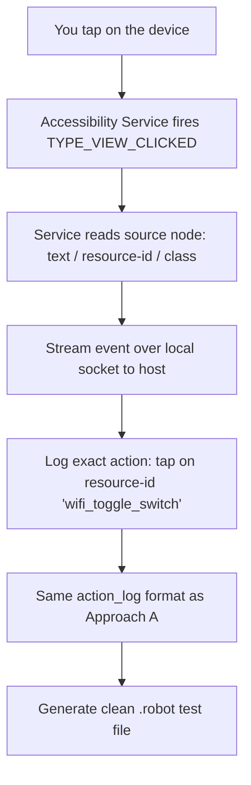
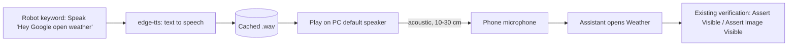
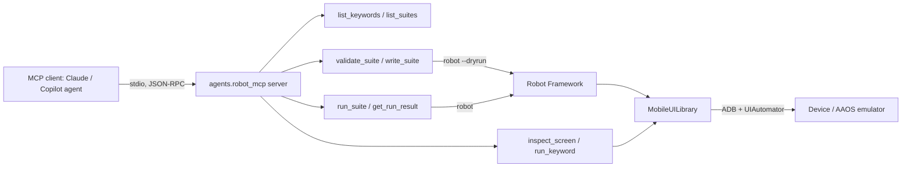

# AgentQA — Multi-Agent Regression Test Orchestrator for Android-Based HMIs

> A custom, dependency-light UI automation engine (Python + Robot Framework) combined with an AI multi-agent layer that records, plans, executes, triages, and reports regression tests automatically. Built for Android-based infotainment and industrial touchscreen systems.

**Status:** Phase 1 (core engine + Recorder Agent, Approach A) is implemented and verified on an Android Automotive OS emulator. The Planner, Executor, Triage and Reporter agents are implemented and wired with LangGraph (`orchestrator.py`), and SOME/IP keywords are available; both are unit-tested but not yet run end to end on an emulator. See the [Roadmap](#roadmap).

## Highlights

**Stack:** Python, Robot Framework, ADB, OpenCV, Claude API, MCP, LangGraph

- **MCP server** exposing Robot Framework to AI agents for keyword discovery, test authoring, validation and execution *(implemented, see [MCP Server](#mcp-server-robot-framework-for-ai-agents))*
- **ADB / UIAutomator automation engine** packaged as a Robot Framework library, with OpenCV image checks (template matching, visual regression) *(implemented)*
- **Claude-powered Recorder Agent** that converts manual device flows into validated Robot Framework tests, with a rule-based fallback and an optional local LLM via Ollama *(implemented)*
- **Speech-driven tests**: text-to-speech played to the device, verified with the same keywords *(library done, phone run pending)*
- **SOME/IP integration** (COVESA vsomeip) so a single Robot test drives both the HMI and the ECU *(implemented: SOME/IP wire protocol over UDP/TCP; service discovery not included; tested against a simulated ECU)*
- **LangGraph multi-agent orchestration** (Planner, Executor, Triage, Reporter) with retry loop, failure classification and a SQLite flakiness history *(implemented, run with `python orchestrator.py`)*

---

## Table of Contents

- [Motivation](#motivation)
- [What This Project Does](#what-this-project-does)
- [System Architecture](#system-architecture)
- [Core Automation Engine](#core-automation-engine)
- [Recorder Agent: Auto-Generating Test Cases from Live Device Interaction](#recorder-agent-auto-generating-test-cases-from-live-device-interaction)
- [Speech Testing (Proof of Concept)](#speech-testing-proof-of-concept)
- [Multi-Agent Orchestration Layer](#multi-agent-orchestration-layer)
- [MCP Server: Robot Framework for AI Agents](#mcp-server-robot-framework-for-ai-agents)
- [Tech Stack](#tech-stack)
- [System Requirements](#system-requirements)
- [Project Structure](#project-structure)
- [Installation](#installation)
- [Usage](#usage)
- [Testing](#testing)
- [Performance Notes: v1 vs v2](#performance-notes-v1-vs-v2)
- [Roadmap](#roadmap)
- [Why This Project](#why-this-project)
- [License](#license)

---

## Motivation

Regression testing for infotainment and industrial HMIs is expensive to maintain: test scripts break on every UI change, triaging failures is manual and slow, and most existing frameworks (Appium, Maestro) are either heavyweight or closed around a specific UI-matching philosophy.

This project has two parts:

1. **A custom, lightweight UI automation engine**, built directly on ADB and Android's built-in UIAutomator service and wrapped as a Robot Framework library. Test cases stay plain, human-readable, and portable to *any* Android-based touchscreen system (automotive, industrial, medical, kiosk), not just one vendor's stack.
2. **A multi-agent AI layer** on top of it: agents that record flows, plan what to test, execute it, reason about failures, and report bugs, largely without manual test-suite maintenance.

---

## What This Project Does

- Records a manual flow on the device and converts it into a clean Robot Framework test *(implemented)*
- Generates and/or selects regression test cases based on a requirements/changelog input
- Executes those test cases against a real Android-based HMI (via ADB) or emulator (e.g. Android Automotive OS)
- Automatically classifies failures as **genuine regression**, **flaky test**, or **environment issue**
- Drafts a human-readable bug report / summary for each run

---

## System Architecture



**Flow in words:**
1. A requirements or changelog document is fed to the **Planner Agent**, which decides what needs testing and writes/updates `.robot` test files. Alternatively, the **Recorder Agent** turns a manually performed flow into a `.robot` file.
2. The **Executor Agent** runs those test files using the custom automation engine, which talks to the device purely through ADB.
3. Failures are handed to the **Triage Agent**, which uses screenshots, logs and historical flakiness data (SQLite) to reason about *why* something failed.
4. Genuine regressions go to the **Reporter Agent**, which drafts a bug report. Flaky and environment issues are logged and retried instead of polluting the bug tracker.

---

## Core Automation Engine

This replicates the mechanism tools like Maestro rely on (Android's built-in UIAutomator service), without depending on Maestro/Appium itself.

### How a single "Tap On Text" action works



### Engine components

| Component | File | Responsibility |
|---|---|---|
| `ADBClient` | `engine/adb_client.py` | Wraps raw ADB calls: dump UI (with retry on "could not get idle state"), tap, swipe, input text, key events, screenshot, screen size, touch-device discovery |
| `UITree` | `engine/ui_tree.py` | Parses the UIAutomator XML dump into a queryable tree (by text, resource-id, content-desc), and resolves a screen point to the most stable locator |
| `wait_until()` | `engine/wait.py` | Polls until a condition holds or a timeout is hit (flakiness tolerance) |
| `MobileUILibrary` | `engine/MobileUILibrary.py` | Robot Framework keyword library: `Tap On Text` / `Tap On Id` / `Tap On Description` (with `index=` for repeated labels), `Scroll To Text`, `Scroll`, `Set Slider`, `Input Text`, `Press Back`, `Restart App`, `Wait Until Screen Is Stable`, `Assert Visible`, `Assert Not Visible`, `Take Screenshot`, `Assert Image Visible` / `Tap On Image`, `Assert Screenshot Matches`, and `Tap On Point` as a last resort |
| `image_match` | `engine/image_match.py` | Template matching (`cv2.matchTemplate`, normalized cross-correlation) and visual-regression diffing (Pillow), on saved PNG paths only — no ADB or Robot Framework dependency, unit-tested with synthetic images |

### Example test case (Robot Framework)

```robotframework
*** Settings ***
Library    engine.MobileUILibrary    device=${DEVICE}

*** Variables ***
${DEVICE}    ${None}

*** Test Cases ***
Open Display Settings
    Restart App      com.android.car.settings
    Tap On Text      Display
    Assert Visible   Brightness level
    Tap On Text      Sound
    Assert Not Visible    Brightness level
```

The example uses Display/Sound settings because they exist on the stock AAOS emulator. Hardware-dependent flows such as Bluetooth pairing need a real head unit.

Robot Framework generates `log.html` and `report.html` automatically, so the base engine needs no custom reporting dashboard. On failure the library embeds a screenshot in the log.

### Image Verification

Text/id-based checks (`Assert Visible`, `Tap On Text`, ...) can't see or target elements the UIAutomator dump doesn't describe — a map preview, a video thumbnail, a custom-drawn icon with no accessibility label — and can't tell whether a screen *looks* right (correct color, no broken layout, not a blank render). Two keywords cover those gaps, backed by `engine/image_match.py`:

**Template matching** — find a small reference image anywhere on the current screen, and optionally tap it. Capture the reference once with `python -m agents.recorder_agent capture-template --name apps_grid_icon --text Applications` (see [Usage](#usage)), which saves it under `templates/<name>.png`:
```robotframework
Assert Image Visible    apps_grid_icon
Tap On Image            apps_grid_icon    threshold=0.8
```
This is the more valuable of the two for this project: it survives layout shifts that would break a hardcoded `Tap On Point`, and is the natural next step past raw coordinates for elements with genuinely no text/id at all — a lightweight precursor to the vision-based fallback backend in the [Roadmap](#roadmap).

**Visual regression** — diff the whole screen (or a cropped `region=`) against a saved baseline:
```robotframework
Assert Screenshot Matches    home_screen    threshold=98
```
The first run with no baseline under `baselines/<name>.png` saves one and passes; every later run compares against it. This catches real rendering bugs that structural checks miss entirely, but it's inherently more fragile than text-based checks — a clock, an animation frame, or a different GPU/driver can shift pixels with nothing actually wrong. Use `region=` to crop out anything expected to vary, and re-approve a baseline deliberately (`update_baselines=true` as a Library import arg, or `--variable UPDATE_BASELINES:true`) rather than deleting the file by hand. Baselines and templates are committed to the repo like source code — see `tests/robot/smoke_image_verification.robot` for a working example of both.

---

## Recorder Agent: Auto-Generating Test Cases from Live Device Interaction

Instead of hand-writing `.robot` files, you (or a manual tester) perform a flow once on the real device/emulator, and the agent converts what happened into a clean, ready-to-run test script. Two capture strategies are planned: **Approach A is implemented as the proof of concept**, and Approach B is the long-term, more precise path.

### Approach A — Raw touch event capture (implemented; no device-side app required)

Works with nothing but ADB. Correlates raw kernel touch events with a UI hierarchy snapshot to figure out *what* was tapped.



Four details make this work reliably:

1. **Resolve against the screen the user saw, not the next one.** A UI dump taken after a tap already shows the next screen. The recorder therefore keeps dumping the UI in the background while nobody is touching the screen, and discards any dump during which a finger went down. Each gesture is resolved against the newest clean snapshot. If the user acts before a fresh snapshot exists, the step is flagged `stale_snapshot` and becomes a `# NOTE:` in the generated test.
2. **Raw coordinates are not pixels.** `getevent` reports touch-panel units (e.g. `0–32767` on the emulator). The recorder reads each panel's range from `getevent -pl` and the display size from `wm size`, then scales.
3. **No hard-coded input device.** Every device that reports `ABS_MT_POSITION_X` is treated as a touch panel (the AAOS emulator exposes several), and `KEY_BACK`/`KEY_HOME` from any device are recorded as key presses.
4. **The kernel only re-sends changed axes.** A second tap at the same spot carries no new X/Y events, so the last known position is kept between gestures instead of being reset.

**Gesture tracking** (`agents/recorder/gestures.py`, simplified):
```python
def feed(self, ev):
    if ev.code == "ABS_MT_POSITION_X":   st.x = ev.int_value      # kept across gestures
    elif ev.code == "ABS_MT_POSITION_Y": st.y = ev.int_value
    elif ev.code == "BTN_TOUCH" and ev.value == "DOWN": st.pending_down = True
    elif ev.code == "BTN_TOUCH" and ev.value == "UP":   st.pending_up = True
    elif ev.code == "SYN_REPORT":
        # on SYN: record the point; on the frame containing UP, emit a gesture:
        # moved > 30 px -> swipe, held >= 600 ms -> long_press, otherwise tap
        ...
```

**Resolving a tap to a locator** (`UITree.locator_for_point`): the smallest element containing the point is found first. If the tap landed on row padding or an icon, the clickable ancestor's subtree is searched for a label. The preference order is unique text > unique resource-id > unique content-desc > raw coordinates (`Tap On Point`, flagged in the output).

**Text entry:** taps inside the on-screen keyboard are ignored. The keyboard area is the IME window's *touchable region* from `dumpsys window InputMethod`, used only when that window reports `isVisible=true`, because `input_method`'s `mIsInputViewShown` stays `true` after the keyboard hides. The typed text is read from the *focused* `EditText` across snapshots and emitted as a single `Input Text` step. Using the focused field matters because a field often appears only after the tap that opens it, e.g. a search bar. `uiautomator` captures the screen near the *end* of its ~2 s run, so a snapshot counts as "before typing" only if it *finished* before the first keystroke.

**Trade-offs:** zero device-side installation, but each snapshot costs a full `uiautomator dump`, measured at 2.0–2.2 s on the AAOS emulator. A tester has to pause ~3 s between actions, or steps get flagged as stale. A stale step is usually still correct, since the recorder falls back to the previous snapshot, but it is marked for review.

**No coordinates in generated tests.** Tests should read like the UI (`Tap On Text    System`), not `Tap On Point    693    725`. Three mechanisms make that the normal case:
1. **`uiautomator dump --windows`** (undocumented, Android 13+) includes the system bars and keyboard, so a tap on the AAOS app-grid button becomes `Tap On Description    Applications`. A tap that lands just beside a button snaps to the nearest button within 40 px. A label that appears twice (e.g. driver and passenger `Lower temperature`) is recorded with `index=2`, instead of falling back to a panel's id or to coordinates.
2. **Scrolling:** swipes that scroll a list to reach the next tapped item become one `Scroll To Text    System    direction=up`. Other swipes become `Scroll    up    container=<list id>`.
3. **Locator repair:** if steps were done before the recorder captured the new screen, pressing Ctrl+C triggers one replay of the flow on the device. The replay waits for each screen to settle, captures it, and swaps coordinates for text or id. It stops, and changes nothing further, if the replay stops matching the recording. It also runs standalone: `python -m agents.recorder_agent repair --recording recordings/<name>.json`. Skip it with `--no-repair`.

`Tap On Point` now appears only when an element really has no text, description or id. Generated tests put `Wait Until Screen Is Stable` before it.

**Known limitations (Approach A):**
- On devices without `dump --windows`, system-bar taps fall back to `Tap On Point` (the repair pass can't resolve them either).
- On the AAOS emulator, hardware keys sent through the emulator console never reach the guest's input devices, so Back/Home recording can't be exercised there. Real head units' hardware and steering-wheel keys arrive as `KEY_BACK`/`KEY_HOME` in `getevent`, and this path is unit-tested.
- Approach B removes all three limitations above.

**Verified end to end:** `tools/verify_recorder.ps1` replays a scripted flow using real kernel-level touch events (`adb emu event mouse`), which is what a click on the emulator window produces. The flow covers taps on labels, a tap on row padding, an icon with no text, a search field with typed text, and a search result. The script then records the flow, generates a test, and replays it with Robot Framework. The example output is in `recordings/examples/` and `tests/robot/display_search_demo.robot`.

### Approach B — Companion Accessibility Service (planned; more precise)

A small Accessibility Service APK (Kotlin, Android Studio) installed once on the device listens directly to `AccessibilityEvent` callbacks (`TYPE_VIEW_CLICKED`, `TYPE_VIEW_TEXT_CHANGED`). It streams the exact source node (resource-id, text, class) to the host over a local socket, so there is no coordinate guessing.



**Trade-offs:** requires installing and enabling one Accessibility Service app on the target device. In return it gives exact element identity every time and needs no per-tap UI dump. The same service doubles as the persistent on-device instrumentation service in the [Roadmap](#roadmap), so building it once pays off in two places.

### Generating the test file from a recording (either approach)

Both approaches produce the same `action_log` (saved to `recordings/<name>.json`). Each entry records the action, its locator, and the texts visible before and after it:

```json
{"action": "tap", "x": 312, "y": 170, "locator_type": "text", "locator_value": "Display",
 "unique": true, "screen_before": ["Settings", "Display", "Sound"],
 "screen_after": ["Display", "Brightness", "Adaptive brightness"]}
```

Two generators turn this log into a `.robot` file:

| Generator | How | Use |
|---|---|---|
| **Rule-based** | Deterministic mapping of actions to keywords. After each screen change it adds `Assert Visible` for a text that appeared in `screen_after` | Offline baseline. Also the reference for checking the LLM output |
| **LLM** (`claude-sonnet-5`) | Given the action log and the keyword list, Claude names the test, keeps every step, and picks meaningful assertions using only texts that were really on screen | Readable, reviewer-ready tests |

Both outputs pass through `validate_robot()`. It parses the file with Robot Framework's own parser and rejects any keyword that the library or BuiltIn doesn't provide. If Claude's output fails validation, the errors are sent back once for a correction before the suite is written.

**Batch vs. streaming generation:** batch mode (record the whole session, generate once at the end) is implemented. Streaming generation is a later polish step, not a core requirement.

---

## Speech Testing (Proof of Concept)

> **Status: library implemented and unit-tested; synthesis and playback verified on the PC. The phone run (microphone to assistant) is not yet verified.**

Some test cases are voice-driven, for example *"Hey Google, open weather"*. The idea is to turn the phrase into audio on the PC, play it so the device hears it through its microphone, and let the existing keywords verify the result, exactly as in any other `.robot` test.



### Scope of the first proof of concept

| Decision | Choice |
|---|---|
| Device under test | An Android phone connected over ADB (real automotive hardware comes later) |
| Language | English only |
| TTS engine | [`edge-tts`](https://pypi.org/project/edge-tts/): free, no API key, neural voices, needs internet (available) |
| Audio output | The PC's default speaker, placed 10-30 cm from the phone's microphone, in a quiet room |
| Caching | Generated WAVs are cached by hash of text, voice and rate, so each phrase is synthesized once |

### Keywords (`engine/SpeechLibrary.py`, logic in `engine/speech.py`)

```robotframework
*** Settings ***
Library    engine.MobileUILibrary
Library    engine.SpeechLibrary

*** Test Cases ***
Open Weather By Voice
    Speak                     Hey Google, open weather
    Wait Until Screen Is Stable
    Assert Visible            Weather
```

| Keyword | Purpose |
|---|---|
| `Speak    <text>` | Synthesize (or reuse the cached WAV) and play it on the configured output device |
| `Launch Assistant By ADB` | `adb shell input keyevent KEYCODE_VOICE_ASSIST`: opens the assistant without the hotword, for a more reliable run |
| `Speak Command    <text>` | `Launch Assistant By ADB` followed by `Speak`, for the command only ("open weather") |
| `Pre Generate Speech    <text> ...` | Cache phrases without playing them, so a later run needs no internet |

Settings go in `.env`: `SPEECH_VOICE` (e.g. `en-US-AriaNeural`), `SPEECH_RATE`, `SPEECH_VOLUME`, `SPEECH_OUTPUT_DEVICE` (empty = PC default). Dependencies (in `requirements.txt`): `edge-tts`, `sounddevice`, `soundfile`. Generated audio is cached in `recordings/speech/` (git-ignored). A working example is `tests/robot/speech_open_weather.robot`; `SPEECH_OUTPUT_DEVICE` accepts a device index or a name fragment, e.g. `Realtek`.

### Known risks

- **Voice Match.** On a phone, "Hey Google" is usually trained on the owner's voice and may reject synthetic speech. Mitigations: switch Voice Match off if the device allows it, try other neural voices or rates, or skip the hotword with `Launch Assistant By ADB`. The full hotword phrase is then a separate, lower-confidence check. Whether the phone uses Google Assistant or Gemini changes which path works.
- **Acoustic path is noisy.** Background sound and speaker distance cause failures. Calibrate the volume once and keep the setup fixed.
- **Timing.** The assistant needs a moment before it listens, so a short wait follows the hotword.
- **Internet.** `edge-tts` is an unofficial service. It is fine for internal testing, and the cache means reruns work offline.

### Later: real automotive hardware

For a head unit, the speaker-to-mic gap can be replaced by a wired path: a USB audio adapter into the unit's microphone or aux input, **through an attenuator** (line level is far too loud for a mic input). For the Android Automotive emulator, a virtual audio cable (e.g. VB-Cable) routes the audio digitally with no hardware. The keywords stay the same, and only `SPEECH_OUTPUT_DEVICE` changes.

---

## Multi-Agent Orchestration Layer

| Agent | Status | Role | Key Inputs | Key Outputs |
|---|---|---|---|---|
| **Recorder** | ✅ Approach A | Captures live device interactions and converts them into a structured action log | Raw touch events (A) or Accessibility Service events (B) | `recordings/*.json`, generated `.robot` file |
| **Planner** | ✅ Keyword matching | Decides what to test based on what changed | Requirements doc / changelog, existing test repo | New/updated `.robot` test files |
| **Executor** | ✅ | Runs the test suite via the custom engine | `.robot` files | `output.xml`, logs, screenshots |
| **Triage** | ✅ Rule-based + SQLite | Reasons about *why* a test failed | Failure logs, screenshots, flakiness history (SQLite) | Classification: regression / flaky / environment |
| **Reporter** | ✅ Markdown | Produces a human-readable output | Triage results | Bug report draft / run summary |

The agents are orchestrated as a **LangGraph** state machine (`orchestrator.py`): `planner -> executor -> triage -> (executor retry | reporter)`.

- **Planner** matches the changelog against suite names, docs, test names and tags (no changelog = full regression).
- **Executor** runs suites through the same runner as the MCP server.
- **Triage** treats adb/emulator/connection errors as *environment* (not retried), re-runs other failures, and labels a test *flaky* if it passes on retry or *regression* if it keeps failing. Outcomes go to `results/flakiness.db`, which gives a per-test flake rate.
- **Reporter** writes `results/report.md` with a bug-report draft per regression. LLM-based triage and JIRA filing are still on the Roadmap.

---

## MCP Server: Robot Framework for AI Agents

`agents/robot_mcp` exposes the engine and the Robot Framework suites as a **Model Context Protocol (MCP)** server, so any MCP client (Claude Desktop, Claude Code, VS Code Copilot agent mode) can discover keywords, author tests, run them and read the results, without custom glue code per agent. It is also the interface the Planner, Executor and Triage agents will use.



| Tool | What it does |
|---|---|
| `list_suites` | `.robot` files with documentation, test names and tags |
| `list_keywords` | Keywords of `MobileUILibrary`, `SpeechLibrary` or `BuiltIn`, with arguments and docs |
| `list_devices` | Devices/emulators visible to ADB |
| `validate_suite` | Dry run (syntax, keyword names, argument counts) without a device |
| `write_suite` | Saves a suite to `tests/robot/generated/`, **only if its dry run passes** |
| `run_suite` | Runs a suite or folder (test/tag filters, variables, device) and returns per-test status, failure message and the deepest failing keyword |
| `list_runs` / `get_run_result` | Earlier runs; `log.html`, `report.html` and screenshots stay under `results/mcp/<run_id>/` |
| `inspect_screen` | Current screen as elements with text, content-desc, resource-id and bounds (ready-made locators) |
| `run_keyword` | Executes one `MobileUILibrary` keyword live, so an agent can try a step before writing it into a test |

**Guardrails:** paths are resolved inside the project (no `../` escapes), agents can only *write* under `tests/robot/generated/`, only the three listed libraries can be loaded, and bad requests or device problems (no emulator, adb missing) come back as `{"error": ...}` the agent can act on. Robot runs in a subprocess with captured output, so nothing corrupts the stdio protocol.

**Start it** (from the project root, with the venv active):
```powershell
python -m agents.robot_mcp
```

**VS Code (Copilot agent mode)** — `.vscode/mcp.json` is included:
```json
{
  "servers": {
    "agentqa-robot": {
      "type": "stdio",
      "command": "${workspaceFolder}/.venv/Scripts/python.exe",
      "args": ["-m", "agents.robot_mcp"],
      "cwd": "${workspaceFolder}"
    }
  }
}
```

**Claude Desktop** — add to `claude_desktop_config.json` (adjust the path):
```json
{
  "mcpServers": {
    "agentqa-robot": {
      "command": "E:\\LNT\\portfolio\\project_1\\.venv\\Scripts\\python.exe",
      "args": ["-m", "agents.robot_mcp"],
      "env": { "PYTHONPATH": "E:\\LNT\\portfolio\\project_1" }
    }
  }
}
```

**Claude Code:** `claude mcp add agentqa-robot -- python -m agents.robot_mcp` (run from the project root).

Example prompt once connected: *"Start Settings on the emulator, find the Display page, write a test that checks Brightness level is shown, validate it and run it."*

---

## Tech Stack

- **Automation engine:** Python 3.10+, ADB, Android UIAutomator (via `uiautomator dump`)
- **Test authoring:** Robot Framework 7
- **AI orchestration:** LangGraph
- **Agent tool interface:** Model Context Protocol (MCP) server over stdio (`mcp` Python SDK)
- **LLM:** Claude (`claude-sonnet-5`) via the official `anthropic` Python SDK
- **Target environment:** Android Automotive OS emulator (Android Studio SDK), or any Android-based industrial touchscreen device with ADB access
- **Reporting:** Robot Framework's native `log.html` / `report.html`, plus agent-generated summaries
- **Image verification:** OpenCV (`opencv-python-headless`) for template matching, Pillow for visual-regression diffing
- **Unit tests:** pytest, run against saved UI dumps, getevent traces and synthetic images with no device needed

---

## System Requirements

### Core (engine + Recorder Agent — required for every user)

| | Minimum | Recommended |
|---|---|---|
| OS | Windows 10 64-bit / macOS 12+ / Ubuntu 20.04+ | Windows 11 / macOS 14+ / Ubuntu 22.04+ |
| CPU | 4-core x86_64 with hardware virtualization enabled (Intel VT-x / AMD-V) — required by the Android emulator | 6+ core |
| RAM | 8 GB | 16 GB |
| Disk | 10 GB free (Android SDK + one system image + Python venv) | 20 GB free, SSD |
| GPU | None required (the emulator falls back to software rendering, `-gpu swiftshader_indirect`) | Any dedicated GPU (faster emulator rendering) |
| Network | Required during setup only (SDK and dependency downloads) | — |
| Software | Python 3.10+, Android SDK Platform Tools (`adb`), Android Studio or a standalone emulator + one Android/AAOS system image, Robot Framework, OpenCV + Pillow (image verification, ~60 MB combined) | — |

**Virtualization is the one hard blocker.** Without VT-x/AMD-V available and enabled — disabled in BIOS, or running inside a VM without nested virtualization exposed — the Android emulator will not start at all; this is worth checking first on any new machine.

### AI-assisted test generation — pick one

The engine, recorder, and rule-based test generation above work with no AI at all. Generating a test with an LLM (rather than the deterministic rule-based converter) needs one of the following two.

**Option A — Cloud (Claude API).** No addition to the Core table — all inference runs on Anthropic's servers. Needs a stable internet connection and an Anthropic API key with billing enabled (see [Installation](#installation)). Cost is roughly **$0.01–0.02 per generated test case** at Claude Sonnet 5 pricing.

**Option B — Local LLM (offline, no per-use cost).** Needs [Ollama](https://ollama.com) (or an equivalent local runtime) plus one of these model tiers. VRAM/RAM drives what fits; generation happens once after a recording is finished, not in the interactive loop, so even the CPU-only timings are acceptable.

| Tier | Model | Min (CPU-only) | Recommended (GPU) | Time per test* | Download size |
|---|---|---|---|---|---|
| Light | `qwen2.5-coder:3b` | 8 GB RAM | 4 GB VRAM | ~10–20s CPU / ~2–5s GPU | ~2 GB |
| Standard | `qwen2.5-coder:7b` | 16 GB RAM | 6 GB VRAM | ~30–90s CPU / ~5–15s GPU | ~4.5 GB |
| High-accuracy | `qwen2.5-coder:14b` | 32 GB RAM | 10–12 GB VRAM | several min CPU / ~15–30s GPU | ~9 GB |

*Per single test-case generation.

---

## Project Structure

```
project_1/
├── engine/
│   ├── adb_client.py          # ADB wrapper: dump, tap, swipe, input, screenshot, device info
│   ├── ui_tree.py             # UIAutomator XML parser + element / point locator
│   ├── wait.py                # Polling / retry logic
│   ├── image_match.py         # Template matching + visual-regression diffing
│   ├── speech.py              # edge-tts synthesis + cache, audio playback
│   ├── someip.py              # SOME/IP header + UDP/TCP request/response client
│   ├── SomeIpLibrary.py       # Robot Framework keywords: Send SomeIP Request, ...
│   ├── SpeechLibrary.py       # Robot Framework keywords: Speak, Speak Command, ...
│   └── MobileUILibrary.py     # Robot Framework keyword library
├── agents/
│   ├── planner_agent.py       # changelog -> suites
│   ├── executor_agent.py      # runs suites
│   ├── triage_agent.py        # regression / flaky / environment + SQLite history
│   ├── reporter_agent.py      # Markdown run summary
│   ├── recorder/
│   │   ├── gestures.py        # getevent parser + tap/long-press/swipe/key tracker
│   │   ├── session.py         # capture loop, pre-touch UI snapshots, action log
│   │   └── generator.py       # rule-based + Claude .robot generation, validation
│   ├── recorder_agent.py      # CLI: record / generate / inspect
├── android/                   # (planned) Approach B Accessibility Service, Android Studio project
├── recordings/                # captured action logs (*.json) + raw getevent streams
│   └── examples/              # verified example recording
├── templates/                 # reference PNGs for Assert Image Visible / Tap On Image
├── baselines/                 # saved screenshots for Assert Screenshot Matches
├── tools/
│   ├── simulate_user.py       # drives the emulator with kernel-level touches (adb emu event)
│   ├── record_demo.ps1        # records the scripted flow end to end
│   └── verify_recorder.ps1    # record -> generate -> replay loop, N runs
├── tests/
│   ├── robot/                 # generated / maintained .robot suites
│   └── unit/                  # pytest unit tests + fixtures
├── orchestrator.py            # LangGraph graph wiring the agents
├── requirements.txt
└── README.md
```

---

## Installation

**Windows (PowerShell):**
```powershell
git clone https://github.com/<your-username>/agentqa.git
cd agentqa
python -m venv .venv
.\.venv\Scripts\Activate.ps1
pip install -r requirements.txt

# Start the AAOS emulator (or connect a device), then confirm ADB sees it
emulator -avd Automotive_1408p_landscape
adb devices

# Claude API key (only needed for LLM generation): put it in .env (git-ignored, loaded automatically)
#   ANTHROPIC_API_KEY=sk-ant-...
#   ANTHROPIC_WORKSPACE_ID=wrkspc_...   # only if the key isn't created inside a workspace
```

**macOS / Linux:**
```bash
python -m venv .venv && source .venv/bin/activate
pip install -r requirements.txt
adb devices
export ANTHROPIC_API_KEY=your_key_here
```

**Troubleshooting**
- **Recorder ignores Ctrl+C:** fixed. `adb shell -tt` used to take over the terminal and switch it to raw mode, so Ctrl+C went to the device instead. adb is now always started without the terminal as input. The recording is autosaved after every step, and it stops by itself if the emulator closes.
- **`Claude API error (400) ... not scoped to a workspace`:** create the API key inside a workspace in the Claude Console, or add `ANTHROPIC_WORKSPACE_ID` to `.env`.
- **Emulator stuck `offline` / window "Not Responding":** start it with software rendering: `emulator -avd Automotive_1408p_landscape -gpu swiftshader_indirect -no-snapshot`.
- **More than one adb installed:** use the Android SDK's copy (`<sdk>/platform-tools`). A different-version adb server can leave the device `offline`. The engine prefers the SDK copy automatically.
- **`robot` fails with `unknown encoding: utf-8:surrogateescape`:** Robot Framework can't handle `PYTHONIOENCODING` values that include an error handler. Run `Remove-Item Env:PYTHONIOENCODING` (or `unset PYTHONIOENCODING`) first.

## Usage

**Record a flow and generate a test (Recorder Agent):**
```bash
python -m agents.recorder_agent record --name display_settings
# wait for "[recorder] ready", perform the flow on the device, pausing ~3 s between steps, then Ctrl+C
# -> recordings/display_settings.json (+ .events.txt with the raw getevent stream)
# -> tests/robot/display_settings.robot        (Claude)
# -> tests/robot/display_settings.rules.robot  (rule-based baseline)
```

Options: `--generator llm|rules|both` (default `both`), `--device emulator-5554`, `--duration 60`.

**Regenerate a test from a saved recording:**
```bash
python -m agents.recorder_agent generate --recording recordings/display_settings.json
```

**Inspect the current screen's UI tree (for writing locators by hand):**
```bash
python -m agents.recorder_agent inspect
```

**Capture a reference image for `Assert Image Visible` / `Tap On Image`:**
```bash
# by an existing locator (text/content-desc, same matching as Tap On Text)
python -m agents.recorder_agent capture-template --name apps_grid_icon --text Applications

# by raw pixel bounds - for an element with no text/id/desc at all, the actual reason to
# reach for image verification; get coordinates from `inspect` or a screenshot
python -m agents.recorder_agent capture-template --name play_button --bounds 100,200,164,264
```
Crops the region from a live screenshot into `templates/<name>.png` and immediately self-checks it. A crop that's nearly a single flat color is rejected (`find_template` refuses it too, at test time) — normalized cross-correlation becomes numerically degenerate on a uniform template and reports a spuriously perfect match almost anywhere, which would silently pass a test that should fail. Pick a region with real visual detail (an icon's outline, not just its flat interior).

**Run a test suite (engine only, no AI):**
```bash
robot --pythonpath . --outputdir results tests/robot/display_settings.robot
# optionally: --variable DEVICE:emulator-5554
```

**Run the full agent pipeline (Planner, Executor, Triage, Reporter):**
```bash
python orchestrator.py --changelog changelog.md --device emulator-5554
```

**Drive the ECU and the HMI from one test (SOME/IP):** see `tests/robot/someip_hmi_ecu.robot`. Keywords: `Connect To SomeIP Service`, `Send SomeIP Request`, `Send SomeIP Request And Expect`, `Send SomeIP Fire And Forget`, `Wait For SomeIP Notification`. `engine/someip.py` implements the SOME/IP wire format directly (unicast, UDP or TCP) so it can talk to a COVESA vsomeip application on the ECU; SOME/IP-SD is not implemented, so address, service id and method id are given explicitly.

---

## Testing

```bash
pytest            # unit tests: XML parser, locators (incl. a real AAOS dump), gestures, generators
robot --dryrun --pythonpath . tests/robot   # syntax/keyword check of all suites without a device
robot --pythonpath . --outputdir results tests/robot   # run all suites on the emulator
```

**Recorder end-to-end check (Windows, emulator running):**
```powershell
powershell -ExecutionPolicy Bypass -File tools\verify_recorder.ps1 -Runs 2
```
It records the scripted flow in `tools/simulate_user.py`, generates a test, and replays it. Every run must pass.

---

## Performance Notes: v1 vs v2

| | v1 (naive dump-per-action) | v2 (optimized) |
|---|---|---|
| Approach | `adb shell uiautomator dump` + `adb exec-out cat` before every action | Reduced dump frequency, `exec-out` streaming of the dump, persistent on-device instrumentation service (Approach B service) |
| Latency per action | Measured on the AAOS API 35 emulator: `uiautomator dump` 2.0–2.2 s; `Tap On Text` (dump + find + tap) ≈ 2.2 s | Target: <150 ms with persistent service |
| Notes | Simple to build, good for proving the concept | Same idea as Appium's UiAutomator2 server: a long-lived on-device process instead of a new `adb shell` per action |

*(Emulator: Android 15 AAOS, 1408x792, `-gpu swiftshader_indirect`. A full v1-vs-v2 benchmark, including real hardware, is on the Roadmap.)*

---

## Roadmap

- [x] Core engine: ADB client, UI tree, wait logic, Robot Framework keyword library
- [x] Recorder Agent — Approach A (raw touch capture via `getevent`, pre-touch snapshots, rule-based + Claude generation)
- [x] Image verification: template matching (`Assert Image Visible` / `Tap On Image`) and visual regression (`Assert Screenshot Matches`), backed by OpenCV + Pillow
- [x] MCP server exposing Robot Framework (discover, validate, write, run, inspect) to AI agents
- [~] Speech testing proof of concept (library done; phone run pending): `SpeechLibrary` (edge-tts + PC speaker) on an Android phone, English only; later a wired path to real automotive hardware
- [x] Planner, Executor, Triage, Reporter agents wired with LangGraph (LLM-based triage still to do)
- [x] SOME/IP keywords (`SomeIpLibrary`): one test drives the HMI and the ECU. Still to do: SOME/IP-SD, and a run against a real vsomeip service
- [x] Flakiness-history database (SQLite); feeding it into triage decisions is still to do
- [ ] Benchmark v1 vs v2 latency and fill in the table above
- [ ] Recorder Agent — Approach B (companion Accessibility Service, Android Studio / Kotlin)
- [ ] Persistent on-device instrumentation service (reuses the Approach B APK; replaces per-action `adb shell` spawning)
- [ ] Vision-based fallback backend for non-Android HMIs (QNX, embedded Linux/Qt) — the template-matching keywords above are the Android-side precursor to this
- [ ] JIRA integration for the Reporter Agent
- [ ] CI pipeline (GitHub Actions) running the suite on an emulator on every PR

---

## Why This Project

Built to demonstrate the intersection of classic test automation engineering and applied AI agent design: reasoning about test planning and failure triage, not just executing scripts. Designed to generalize beyond automotive to any Android-based touchscreen system used in industrial, medical, or kiosk contexts.

---

## License

MIT
